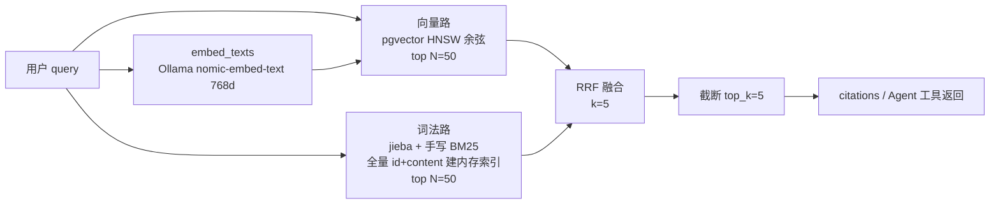
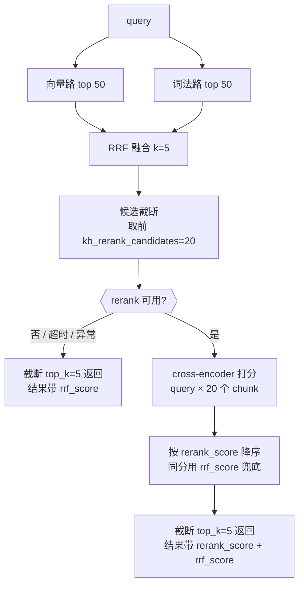

# 检索链路重排序（Rerank）方案

> **本文定位**：可执行的实施方案（不是调研笔记）。给出接入点、选型、参数、分步计划、验收与验证方法。  
> **建立**：2026-10-13 · **状态**：待评审（未落代码）  
> **前置事实来源**：`backend/app/services/kb_service.py`、`app/core/config.py`、`scripts/eval_rag.py`、`data/kb_eval/report.md`（均为本仓库实测）


---

## 0. 结论先行（TL;DR）

| 问题             | 结论                                                                                                                                              |
| -------------- | ----------------------------------------------------------------------------------------------------------------------------------------------- |
| **接在哪**        | `search_chunks_hybrid()` 的 **RRF 融合之后、截断到 `kb_search_top_k` 之前**。改一处，两个调用方（Playground RAG 问答、Agent 的 `kb_search` 工具）自动受益                        |
| **用什么模型**      | **本地 `BAAI/bge-reranker-base`**（sentence-transformers，CPU 可跑）；备选云端 API（阿里云百炼 `gte-rerank-v2`）。**不推荐**走 Ollama —— 官方无原生 rerank 端点，逐条打分需 20 次生成调用 |
| **候选规模**       | 送入 rerank **20 条**（`kb_rerank_candidates`），最终仍取 `kb_search_top_k=5`                                                                             |
| **延迟代价**       | CPU 上 20 条预估 **+1~3 秒**（**必须实测**）。因此配 **1.5 秒超时 + 超时即回退 RRF 结果**的降级护栏                                                                           |
| **怎么融合**       | **rerank 分数决定最终排序，RRF 分数降级为 tie-breaker**；保留 `rrf_score` / `rerank_score` 双字段供归因                                                                |
| **⚠️ 现在值不值得做** | 当前 49 题基线 **hit@5 已是 100%**，rerank 的可量化空间只剩 **hit@1（87.8%）与排序位次（MRR/nDCG）**。**建议先做 P0 离线验证（半天，零风险）**，用真实增益决定 go / no-go；语料从 111 块增长后收益才会显著      |
| **不做**         | 不引入 ColBERT 类延迟交互索引、不自训 reranker、不改 embedding 模型、不动 `Vector(768)` 维度                                                                            |

---

## 0.1 实施状态与实测结果（2026-10-13 更新）

**P0~P3 已全部实施**（代码在本地，未提交）。P0 离线验证结果**超出 go 门**：

| 指标 | vector（基线） | hybrid（当前） | hybrid_rerank | Δ(hybrid→rerank) |
|---|---|---|---|---|
| hit@1 | 35/49 (71.4%) | 43/49 (87.8%) | **48/49 (98.0%)** | **+5 题 / +10.2pp** |
| hit@5 | 45/49 (91.8%) | 49/49 (100%) | 49/49 (100%) | 0（未掉） |
| MRR@5 | 0.8010 | 0.9354 | **0.9898** | +0.0544 |
| nDCG@5 | 0.6045 | 0.7317 | **0.7686** | +0.0369 |

**延迟实测**（CPU-only，`bge-reranker-base` int8 ONNX，20 条候选 × 平均 466 字）：

| max_length | 单次耗时 | 每条 |
|---|---|---|
| 512 | 3.07s | 154ms |
| 256 | 2.28s | 114ms |
| 128 | 1.04s | 52ms |

→ 定档 **10 条候选 × 256 截断 × 3000ms 超时**，整轮 49 题评测实测 **993ms/次、0 降级**。

**go 门判定**：hit@1 ≥ 90% ✓（98.0%）· hit@5 未掉 ✓ · 延迟在预算内 ✓ → **通过**，参数已写进 `config.py` 默认值。

**实施期踩到的两个坑（都已修）**：
1. **ONNX 文件在 HF 仓库的 `onnx/` 子目录**（`Xenova/bge-reranker-base` 的布局），最初只按根目录找 → 模型加载失败、49/49 全部静默降级（报告里"单次均耗时 2ms"是识别信号）。修法是 `_ONNX_FILENAMES` 同时兼容 `onnx/` 前缀与平铺布局。
2. **默认超时 1500ms 在真实块长下必然触发**（~466 字的块，20 条要 2.4s）→ 用实测延迟曲线反推参数，而不是照搬经验值。

**按调用方细分（2026-10-13 追加）**：新增 `kb_rerank_scope` 控制生效范围 —— 默认 `playground`（只有 RAG 问答页走重排序），`all` 则含 Agent 的同步工具链。理由是延迟预算不同：问答页用户能等 1 秒换更准的首条引用；而 Agent 一轮可能多次调检索，每次 +1s 会明显拖慢对话体感。调用方通过 `search_chunks(caller=...)` 声明身份，判据集中在 `kb_service._rerank_allowed()`。

**当前状态**：`kb_rerank_enabled` **仍为默认关闭** —— 功能完整、评测通过、延迟可控，但不擅自改变现有生产行为；是否常开、何时常开由 owner 决定（打开即是"检索延迟 +1s 换 hit@1 +10pp"的取舍）。

---

## 1. 现状盘点（改前的真实链路）

### 1.1 当前检索链路



- 入口：`search_chunks()`（`query_text` + `kb_hybrid_enabled=True` 时转 `search_chunks_hybrid()`；否则退回纯向量 + `kb_min_similarity` 阈值）。
- 两条路各自取 `candidate_n = max(kb_hybrid_candidates, limit)` = **50**；融合后取 `kb_search_top_k` = **5**。
- 词法路**刻意不拉 embedding 大列进内存**（只取 id+content+title 建 BM25），只有"仅词法命中"的块才补取完整实体。
- 混合路径**不套用 `kb_min_similarity`**（"仅词法命中"正是要救回的场景）。

### 1.2 调用方（rerank 的受益面）

| 调用方                      | 位置                               | 用途                            |
| ------------------------ | -------------------------------- | ----------------------------- |
| Playground / 在线对话 RAG 问答 | `app/api/playground.py:161`      | SSE 流式回答 + `citations` 引用来源   |
| Agent `kb_search` 工具     | `app/services/agent/tools/kb.py` | AI 客服检索主链路，支持 `document` 限定单篇 |

> **关键设计约束**：两个调用方都走 `search_chunks()`，所以 rerank **必须做在 service 层**（不要放调用方），否则会出现"两套检索口径"。

### 1.3 现有参数（`backend/app/core/config.py`）

| 配置                         | 当前值        | 说明               |
| -------------------------- | ---------- | ---------------- |
| `kb_search_top_k`          | 5          | 最终返回块数           |
| `kb_hybrid_candidates`     | 50         | 每路召回候选数          |
| `kb_rrf_k`                 | 5          | RRF 平滑常数         |
| `kb_bm25_k1` / `kb_bm25_b` | 1.5 / 0.75 | BM25 参数          |
| `kb_hybrid_enabled`        | True       | 混合检索开关（可一键回退纯向量） |
| `kb_min_similarity`        | ~0.65      | **仅纯向量路径**使用     |

### 1.4 语料与评测现状

| 项    | 实测值                                                                                              |
| ---- | ------------------------------------------------------------------------------------------------ |
| 语料规模 | 7 篇预置文档 / **111 个切块**（用户上传文档会增加）                                                                 |
| 块大小  | ~600 字 / 块，60 字重叠                                                                                |
| 评测集  | `data/kb_eval/qa.json`，**49 题**（人工构造，标注 `expected_titles`）                                       |
| 评测方式 | `scripts/eval_rag.py`：把全部块读进内存，分别按 vector / hybrid 排序，比 **hit@1 / hit@5**（是否命中预期文档），**纯内存、不烧额度** |
| 当前基线 | vector **hit@1 71.4% / hit@5 91.8%** → hybrid **hit@1 87.8% / hit@5 100%**（无任何一题变差）              |

### 1.5 运行环境约束（选型的决定性前提）

| 项      | 实测                                                             |
| ------ | -------------------------------------------------------------- |
| GPU    | **无可用 NVIDIA GPU**（`nvidia-smi` 报 NVML 初始化失败）→ **CPU-only 推理** |
| 现有容器   | `ollama/ollama:latest`（本地 embedding）+ PG/pgvector + Redis      |
| 云端 LLM | DeepSeek（OpenAI 兼容），Key 在 `backend/.env`                       |
| 交互形态   | RAG 问答是 **SSE 流式**、Agent 工具是**同步阻塞**调用 → 检索段延迟直接叠加在用户感知上       |

---

## 2. 接入位置与整体流程设计

### 2.1 为什么放在 RRF 之后

| 备选接入点                          | 评价                                           |
| ------------------------------ | -------------------------------------------- |
| 向量路之后（rerank 向量结果再去融合）         | ❌ 只精排了一路，词法路救回的术语块仍可能被压到后面                   |
| **RRF 融合之后（✅ 选定）**             | ✅ 对"两路合成后的整体排序"做终局裁决；候选来自两条路，覆盖最全；实现最简（一处插入） |
| 调用方内部（playground / agent 各做一次） | ❌ 两套口径必然漂移                                   |

### 2.2 目标链路



**流程要点**

1. RRF 输出的完整融合序列**不丢弃**（它是 rerank 的输入池，也是降级时的兜底结果）。
2. 只有 `kb_rerank_candidates` 条进入打分，控制延迟上界。
3. **任何异常路径（模型未加载 / 超时 / 返回条数不符）都必须静默回退到 RRF 结果**，并在日志与（可选的）返回字段里标记 `reranked: false`。检索链路不允许因 rerank 失败而报错——这是硬约束。
4. 返回结构向后兼容：新增 `rerank_score`（可选）、新增 `reranked` 布尔；**原有 `similarity` / `rrf_score` / `lexical_score` 语义不变**（前端与 Agent 文案不用改）。

### 2.3 需要同步的一处"影子实现"

`scripts/eval_rag.py` 里的 `_hybrid_order()` 是**评测侧复刻**的融合逻辑（不是调 service）。加 rerank 后必须同步扩一个 mode，**否则评测结果与实际链路不一致**（这是本项目已有的一次漂移教训：评测与生产逻辑各写一份）。

---

## 3. 模型 / 服务选型

### 3.1 候选对比

| # | 方案                           | 模型示例                                                           | 延迟（20 候选，CPU）    | 成本           | 新增依赖                   | 结论                                           |
| - | ---------------------------- | -------------------------------------------------------------- | ---------------- | ------------ | ---------------------- | -------------------------------------------- |
| A | **本地 sentence-transformers** | `BAAI/bge-reranker-base`（~1.1GB）/ `bge-reranker-v2-m3`（~2.3GB） | 预估 1~3s（**待实测**） | 0            | 模型文件 + 1 个 Python 依赖   | ✅ **推荐主方案**                                  |
| B | 本地容器化 rerank 服务              | TEI / Xinference 托管 `bge-reranker-v2-m3`                       | 预估 2~5s（CPU）     | 0            | **新增一个容器 + 镜像**（~GB 级） | ⚠️ 备选；数据量大时再上，避免为 111 块语料多加一个常驻容器            |
| C | **云端 rerank API**            | 阿里云百炼 `gte-rerank-v2`、Cohere Rerank、Jina Rerank                | **100~400ms**    | 按次计费（千次级约几元） | 网络 + Key               | ✅ **备选主方案**；现有 OA 项目已接入百炼，通道可复用              |
| D | 复用现有 LLM 做"列表式 rerank"       | DeepSeek（一次请求排 20 条）                                           | 1~3s             | 低（一次调用）      | 0                      | ⚠️ 兜底可用；排序质量与稳定性弱于 cross-encoder，且占用 LLM 额度  |
| E | Ollama 跑 rerank 模型           | 社区量化 `bge-reranker-v2-m3`                                      | **不可接受**         | 0            | 无                      | ❌ Ollama 官方**无原生 rerank 端点**；逐条打分 = 20 次生成调用 |

> 关于 E 的核实结论：Ollama 的 rerank 能力目前来自社区 PR（`/api/rerank` + OpenAI/Jina 兼容 `/v1/rerank`），**未确认进入稳定版**；即便可用，也应通过独立的 rerank 端点而非 `/api/generate` 拼 prompt 打分（后者每条候选一次生成，延迟不可控）。选型时以**实测**为准，不要赌未发布的接口。

### 3.2 选型判据（不是"哪个最强"）

1. **延迟预算**：RAG 问答是流式、Agent 工具是阻塞调用，检索段增加 1 秒以上用户可感知 → 延迟权重最高。
2. **是否可离线/无网络依赖**：本地模型零网络、零费用、数据不出机；API 反之。
3. **语料规模**：当前 111 块，候选池总共也就 111 条 —— 大模型的能力优势体现不出来，"够用 + 便宜 + 快"更重要。
4. **运维成本**：新增一个常驻容器（方案 B）对个人作品集项目不划算。
5. **可回退性**：必须有开关，且开关关闭时行为与基线**逐字节一致**。

### 3.3 推荐路线

- **主方案 = A（本地 `BAAI/bge-reranker-base`）**：中文效果足够（BGE 系列对中文优化），CPU 可跑，零成本零网络。
- **若 P0 实测 CPU 延迟 > 3 秒**（p95）→ 切 **C（百炼 `gte-rerank-v2`）**，代价是付费 + 网络依赖。
- **模型下载与运行方式**：与现有 `asr_service`（faster-whisper 懒加载单例、模型预下载）保持一致的工程姿态 —— **懒加载 + 单例 + 首次加载日志 + 加载失败不影响服务启动**。
- **`bge-reranker-base` vs `v2-m3`**：先用 base（1.1GB / 更快）；P0 若发现排序质量不足再换 v2-m3（2.3GB，质量更好但 CPU 更慢）。**不要一开始就上大模型**。

---

## 4. 候选集规模与截断策略

### 4.1 三级截断

| 级别          | 参数                     | 建议值           | 理由                                                                     |
| ----------- | ---------------------- | ------------- | ---------------------------------------------------------------------- |
| ① 路内召回      | `kb_hybrid_candidates` | **保持 50**（不改） | 已通过评测扫描选定；改它会影响 RRF 基线，属于"另一个变量"                                       |
| ② 送入 rerank | `kb_rerank_candidates` | **20**        | cross-encoder 延迟与候选数**近似线性**；20 是精度/延迟的经验平衡点；当前语料仅 111 块，20 已覆盖 RRF 头部 |
| ③ 最终返回      | `kb_search_top_k`      | **保持 5**      | 引用来源展示与 LLM 上下文预算已按 5 调优                                               |

### 4.2 截断规则

- ② 的截断按 **RRF 分降序**取前 20；候选不足 20 时用实际条数（**不要补空、不要报错**）。
- ③ 的截断按 **rerank 分降序**；**同分时用 RRF 分作 tie-breaker**（保证结果稳定可复现）。
- **不设 rerank 分数阈值**（不做 `rerank_min_score` 过滤）：cross-encoder 分数分布依赖模型与语料，硬阈值容易误杀；当前 RRF 阶段也没有做分数过滤。若 P0 数据显示"低分块确实有害"，再把阈值作为可选项引入（默认关闭）。

---

## 5. 性能与延迟权衡

### 5.1 延迟预算（改前 / 改后）

| 环节                           | 改前（实测/已知）      | 改后（预估，**P0 必须实测替换**）     |
| ---------------------------- | -------------- | ------------------------ |
| embedding（Ollama 本地）         | ~~50~~200ms    | 不变                       |
| 向量路 HNSW top 50              | 10~50ms（当前语料）  | 不变                       |
| 词法路（全量拉 id+content + 建 BM25） | 10~50ms（111 块） | 不变                       |
| RRF 融合                       | <10ms          | 不变                       |
| **rerank 20 条（本地 CPU）**      | —              | **+1000~3000ms** ⚠️ 主要风险 |
| 检索段合计                        | ~~100~~300ms   | ~~1.1~~3.3s              |

### 5.2 降级与护栏（必须实现，不是可选项）

| 机制             | 参数                                   | 行为                                        |
| -------------- | ------------------------------------ | ----------------------------------------- |
| **超时熔断**       | `kb_rerank_timeout_ms = 1500`        | 超时立即返回 RRF 结果，日志 warn（含耗时）                |
| **异常兜底**       | —                                    | 模型加载失败 / 推理异常 / 返回条数不符 → 回退 RRF，**绝不向上抛** |
| **开关**         | `kb_rerank_enabled = False`（**默认关**） | 关闭时链路与当前完全一致（可做逐字节回归对比）                   |
| **候选裁剪**       | `kb_rerank_candidates`               | 延迟超标时第一个调它（20 → 10）                       |
| **模型懒加载 + 单例** | —                                    | 首次调用加载（记录加载耗时），后续复用；避免每次请求重新载模型           |
| **预热（可选）**     | —                                    | 应用启动后台线程预热，避免"第一次查询特别慢"                   |

### 5.3 若延迟不可接受的三个退路

1. **降候选**：20 → 10（延迟近似砍半）。
2. **换 base → 更小模型**：`bge-reranker-base` 已是小模型；可再退到 `ms-marco-MiniLM`（英文为主，中文效果下降，不推荐）。
3. **切云端 API**（方案 C）：把 1~~3 秒压到 100~~400ms，代价是付费与网络依赖。

> **诚实提示**：CPU-only 环境下做 cross-encoder rerank，延迟就是主要矛盾。若最终接受不了 1 秒以上的检索段增量，**这个能力在本机不值得强行上**——收益见 §9 的 go/no-go 门。

---

## 6. 与现有检索结果的融合方式

### 6.1 三种候选融合策略

| 策略            | 做法                                             | 优点                                         | 缺点                                                               | 建议             |
| ------------- | ---------------------------------------------- | ------------------------------------------ | ---------------------------------------------------------------- | -------------- |
| **① 替换式（推荐）** | rerank 分决定最终顺序；RRF 分仅作同分兜底                     | 简单、可控、可解释；cross-encoder 直接建模 query-doc 相关性 | 完全丢弃 RRF 的"双路共识"信号                                               | ✅ **默认**       |
| ② 加权融合        | `final = α · norm(rerank) + (1-α) · norm(rrf)` | 保留两路信号                                     | 需要归一化两个不同量纲的分数（RRF 是 1/(k+rank) 累加，rerank 是 0~1 logit）→ **调参黑洞** | ⚠️ 仅作为 A/B 实验项 |
| ③ 只换位次不换集合    | 用 rerank 分对**已入选的 top_k 内部**重排                 | 延迟最低（只 5 条）                                | 无法把"RRF 排 30 名但真的相关"的块提上来，收益极小                                   | ❌ 不作为方案        |

### 6.2 推荐实现（① + 可观测字段）

返回结构（向后兼容，仅**新增**字段）：

```json
{
  "document_id": 12,
  "title": "java_interview",
  "seq": 34,
  "content": "……",
  "similarity": 0.7182,      // 语义相似度（含义不变）
  "rrf_score": 0.183333,     // RRF 融合分（含义不变，现在作为 tie-breaker）
  "lexical_score": 7.42,     // 词法分（含义不变）
  "rerank_score": 0.9137,    // 新增：cross-encoder 相关性（未启用时为 null）
  "reranked": true           // 新增：本次结果是否经过 rerank（降级时为 false）
}
```

- **前端零改动**：`citations` 渲染只用 `title` / `content` / `similarity`。
- **Agent 零改动**：`kb_search` 工具格式化函数只用现有字段。
- **可归因**：保留双分数，评测报告可直接对比"RRF 顺序 vs rerank 顺序"的逐题翻转（复用现有 `eval_rag.py` 的翻转明细格式）。

---

## 7. 关键参数配置建议（`backend/app/core/config.py` 新增）

| 参数 | 类型 | **实际落地值** | 说明 |
| --- | --- | --- | --- |
| `kb_rerank_enabled` | bool | **False** | 总开关。默认关；评测脚本会临时打开以便度量 |
| `kb_rerank_scope` | str | `"playground"` | 生效范围：`playground`（仅 RAG 问答页）/ `all`（含 Agent 的同步工具 `kb_search`） |
| `kb_rerank_provider` | str | `"onnx"` | `onnx`（本地，只需 tokenizers + onnxruntime）/ `api`（云端 `/v1/rerank`） |
| `kb_rerank_model` | str | `"Xenova/bge-reranker-base"` | ONNX 仓库（经 HF 镜像拉取）/ provider=api 时为服务端模型名 |
| `kb_rerank_model_dir` | str | `"models/rerank"` | 本地模型目录（相对 `backend/`，已 gitignore） |
| `kb_rerank_candidates` | int | **10** | 送入 rerank 的候选数（延迟第一旋钮；实测 10 条 ≈1.0s） |
| `kb_rerank_timeout_ms` | int | **3000** | 超时即降级（第二旋钮；约实测均值的 3 倍余量） |
| `kb_rerank_batch_size` | int | 8 | 单批打分条数（内存/吞吐权衡） |
| `kb_rerank_max_length` | int | **256** | query+chunk 截断长度（延迟最敏感项，实测曲线见 §0.1） |
| `kb_rerank_api_base` | str | `""` | provider=api 时的服务地址 |
| `kb_rerank_api_key` | str | `""` | provider=api 时的 Key（放 `.env`，勿入库） |

> 原方案里的 `kb_rerank_weight`（加权融合实验项）**未实现** —— 实际采用更简单的「rerank 定序 + RRF 作 tie-breaker」，不引入需要归一化两种量纲的加权融合；将来要做 A/B 再加。
> 命名与现有 `kb_*` 前缀保持一致，便于在 `settings` 里一眼归组；`eval_rag.py` 与 `check_env.py` 都可读同一份配置。

---

## 8. 分步实施计划

> 每步都**可独立回滚**；一步一 commit（中文 conventional commits）。

### P0 · 离线验证（先做这个，**零风险、不改生产链路**）

| 项  | 内容                                                                                               |
| -- | ------------------------------------------------------------------------------------------------ |
| 动作 | 在 `scripts/eval_rag.py` 的 `MODES` 里加 `"hybrid_rerank"`，在内存语料上跑 49 题；同时记录 **rerank 单次耗时 p50/p95** |
| 产出 | 三路对比报告（vector / hybrid / hybrid_rerank）：hit@1、hit@5、**MRR@5**、**nDCG@5** + 翻转明细；CPU 延迟实测值        |
| 验收 | 报告落 `data/kb_eval/report.md`；**go/no-go 判据见 §9.1**                                               |
| 回滚 | 不涉及生产代码，删除脚本改动即可                                                                                 |

**P0 是 go/no-go 门**：若 hit@1 提升 < 3 个百分点且 MRR 无明显改善，或 p95 延迟 > 3 秒且不接受切 API —— **停止，不上线**（当前 hit@5 已 100%，强行上只会增加延迟与复杂度）。

### P1 · 服务化（不动调用方）

| 项  | 内容                                                                                                                                           |
| -- | -------------------------------------------------------------------------------------------------------------------------------------------- |
| 动作 | 新增 `app/services/rerank_service.py`：懒加载单例 + 批量打分 + 超时 + 异常兜底；签名 `rerank(query: str, docs: list[str], top_n: int) -> list[tuple[int, float]]` |
| 验收 | 单元测试全 mock（不下载模型也能在 CI 跑）：正常排序 / 超时降级 / 异常降级 / 空输入 / 条数不符                                                                                    |
| 回滚 | 新文件，删掉即回到原状                                                                                                                                  |


### P2 · 接入主链路

| 项  | 内容                                                                                                                                            |
| -- | --------------------------------------------------------------------------------------------------------------------------------------------- |
| 动作 | `search_chunks_hybrid()` 在 RRF 排序后插入 rerank 段（`kb_rerank_enabled=False` 时**整段跳过**，零开销）；返回结构加 `rerank_score` / `reranked`                      |
| 验收 | ① 开关关闭时，与改前结果**逐字段一致**（回归对比脚本或单测快照）；② 开关打开时，Playground 问答与 Agent `kb_search` 均正常返回，`citations` 正常渲染；③ 超时注入测试：人为设 `timeout_ms=1`，确认回退 RRF 且不报错 |
| 回滚 | 关开关（配置级回滚，重启即生效）                                                                                                                              |

### P3 · 评测回归与文档收口

| 项  | 内容                                                                                                                                                                                                                       |
| -- | ------------------------------------------------------------------------------------------------------------------------------------------------------------------------------------------------------------------------ |
| 动作 | 跑 `python -m scripts.eval_rag --report` 更新基线；跑 `python -m scripts.eval_agent_routing` 确认工具路由未受影响（kb_search 描述未改，应保持 40/40）；更新 README / AGENTS / `docs/tech-stack-and-features.md` 的检索口径；`check_env` 增加 rerank 可用性检查项（可选） |
| 验收 | 三套评测基线全部记录；全套 pytest 全绿；`ruff check` / `format` 全绿                                                                                                                                                                       |
| 回滚 | 文档与基线可回退；代码仍由开关控制                                                                                                                                                                                                        |

**工作量预估**：P0 半天 · P1 半天 · P2 半天 · P3 半天 = **约 2 人日**（不含 P0 失败后的方案切换）。

---

## 9. 评估指标与验证方法

### 9.1 效果指标（离线，`eval_rag.py`）

| 指标         | 现状基线             | 说明                                   | 目标                     |
| ---------- | ---------------- | ------------------------------------ | ---------------------- |
| **hit@1**  | 87.8%（hybrid）    | 第 1 块是否来自预期文档                        | **≥ 90%**（+2pp 以上才有意义） |
| hit@5      | **100%**（hybrid） | 前 5 块是否含预期文档                         | 保持 100%（**不能再降**）      |
| **MRR@5**  | 待记录（新指标）         | 第一个正确块的位次倒数均值 —— **rerank 的主要收益点**   | 相对 hybrid 提升           |
| **nDCG@5** | 待记录（新指标）         | 排序质量（考虑位次折扣）                         | 相对 hybrid 提升           |
| 逐题翻转       | —                | 复用现有报告格式，标出"rerank 救回 / rerank 变差"的题 | **变差题数 = 0**（否则需查因）    |

> 为什么必须新增 MRR / nDCG：hit@k 是**集合型**指标，而 rerank 改善的是**顺序**。只看 hit@1/5 会低估 rerank 的价值，也会掩盖"把正确块从第 3 提到第 1"这类真实收益。

### 9.2 性能指标

| 指标                    | 采集方式               | 门槛                            |
| --------------------- | ------------------ | ----------------------------- |
| rerank 单次耗时 p50 / p95 | P0 脚本计时 + P2 后日志埋点 | p95 ≤ **1500ms**（否则降候选或切 API） |
| 检索段总耗时 p95            | 服务端日志计时            | ≤ 2.5s                        |
| RAG 问答端到端首字延迟增量       | 真机冒烟（SSE 首事件时间戳）   | ≤ +1.5s                       |
| 内存占用增量                | 容器/进程 RSS          | ≤ 1.5GB（base 模型量级）            |

### 9.3 正确性与回归验证

1. **开关关闭 = 零行为变化**：改前后对同一批 query 的检索结果做**逐字段 diff**（`document_id` / `seq` / `similarity` / `rrf_score` 顺序一致）。
2. **降级路径可用**：人为注入超时 / 异常 / 模型缺失三种故障，验证均返回 RRF 结果且 HTTP 200。
3. **归属隔离不破**：rerank 只能在**已按归属者过滤**的候选池内重排，**不允许引入任何跨用户候选**；补充单测（A 用户 query 不得出现 B 用户 chunk）。
4. **Agent 链路冒烟**：真机问一句需要 `kb_search` 的问题，确认 SSE 里 `action` / `observation` 事件正常、引用来源仍为 4~5 条、回答文案未劣化。
5. **不烧额度**：P0/P1 全离线或全 mock；真机冒烟仅 1~2 次。

### 9.4 A/B 与灰度

- 开关粒度：全局配置（个人项目不做按用户灰度）。
- 对比方式：`kb_rerank_enabled=True/False` 各跑一遍 `eval_rag --report` + 一次真机问答，人工比对引用质量。
- **记录口径**：报告头部写明 rerank 模型名、候选数、超时值、耗时，便于后续复现。

---

## 10. 风险与不做项

### 10.1 风险

| 风险                                   | 影响                  | 缓解                                                                                           |
| ------------------------------------ | ------------------- | -------------------------------------------------------------------------------------------- |
| CPU 延迟超标                             | RAG 问答变慢，Agent 工具阻塞 | 超时熔断 + 候选裁剪 + 切云端 API（§5.3）                                                                  |
| 收益低于预期（hit@5 已 100%）                 | 白增加复杂度              | **P0 作为 go/no-go 门**，不达标即停                                                                   |
| 模型文件体积（1.1~2.3GB）                    | 镜像/磁盘膨胀             | 懒加载 + 不入镜像（挂载或首次下载）；镜像构建不打包模型                                                                |
| 评测与生产逻辑二次实现漂移                        | 评测结论不可信             | P0 与 P2 必须**同时**改 `eval_rag._hybrid_order` 与 `kb_service.search_chunks_hybrid`，并在报告里注明二者对应关系 |
| 引入新依赖（sentence-transformers / torch） | 依赖树膨胀、CI 变慢         | 选 CUDA-free 的 CPU 版 torch；**依赖装/升后必须重新生成 `requirements.lock`**；CI 里 rerank 全 mock，不下载模型      |

### 10.2 明确不做

- ❌ 不引入 ColBERT / 延迟交互式索引（需要重建索引，与 pgvector 现有结构冲突）。
- ❌ 不自训 / 微调 reranker（语料 111 块，无训练价值）。
- ❌ 不改 embedding 模型与向量维度（`Vector(768)` 写死在迁移里，改 = 全量重新入库）。
- ❌ 不用 Ollama 拼 prompt 逐条打分（延迟不可控）。
- ❌ 不引入 Reranker 之外的检索改造（如查询改写、多路扩展）——**一次只动一个变量**，否则评测无法归因。

---

## 附录 A：改动清单（✅ 已全部实施，结果见 §0.1）

| 文件                                                            | 改动                                                       |
| ------------------------------------------------------------- | -------------------------------------------------------- |
| `backend/app/core/config.py`                                  | 新增 §7 的 8 个 `kb_rerank_*` 参数（默认关）                        |
| `backend/app/services/rerank_service.py`                      | **新增**：懒加载单例 + 批量打分 + 超时 + 兜底                            |
| `backend/app/services/kb_service.py`                          | `search_chunks_hybrid()` 尾部插入 rerank 段（开关控制）；返回结构加 2 个字段 |
| `backend/scripts/eval_rag.py`                                 | `MODES` 加 `hybrid_rerank`；新增 MRR@5 / nDCG@5；计时输出         |
| `backend/tests/test_rerank.py`                                | **新增**：正常 / 超时 / 异常 / 空输入 / 归属隔离（全 mock）                 |
| `backend/tests/test_rag.py`                                   | 补：开关关闭时结果与基线一致                                           |
| `docs/tech-stack-and-features.md` · `README.md` · `AGENTS.md` | 检索口径升版（若上线）                                              |
| `backend/requirements.txt` / `requirements.lock`              | 新增依赖（若走本地模型）并**重新生成 lock**                               |

## 附录 B：一页速查

```
开关：kb_rerank_enabled=False（默认关）
位置：search_chunks_hybrid() → RRF 后 → rerank → top_k
模型：BAAI/bge-reranker-base（本地 CPU）｜备选 百炼 gte-rerank-v2
候选：送入 20 条 → 返回 5 条
护栏：1500ms 超时即回退 RRF，异常绝不抛出
融合：rerank 定序，RRF 分作 tie-breaker；双分数都返回
验证：eval_rag 加 hybrid_rerank mode → hit@1/hit@5/MRR@5/nDCG@5 + 延迟 p50/p95
门禁：hit@1 ≥ 90% 且 hit@5 不掉 且 p95 ≤ 1.5s，否则不上线
```
